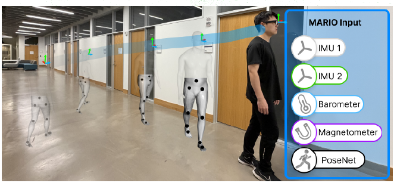
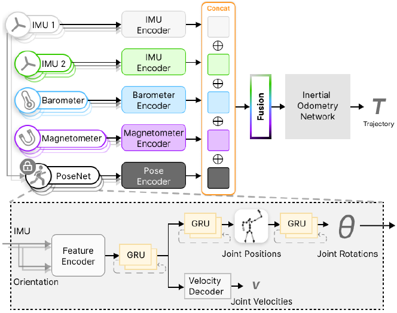
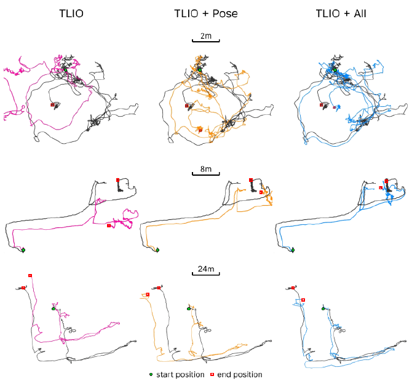

  <strong>One pair of glasses, five signals.</strong> MARIO takes the two IMUs, barometer and magnetometer already built into AR glasses, adds a lower-body pose inferred from the head IMU by a pretrained PoseNet, and feeds all of it to an off-the-shelf inertial odometry network.

## Abstract

Inertial odometry (IO) using only inertial measurement units (IMUs) provides a lightweight solution for human motion tracking in augmented reality (AR) and wearable devices. Recent learning-based IO methods have improved the generalizability of inertial localization through large-scale pretraining on human motion datasets. However, these approaches remain prone to drift and noise because they fail to capture human motion dynamics, especially on daily activity datasets such as Nymeria.

To address this limitation, we ground inertial odometry in human kinematics through a learned IMU-inferred pose prior that encourages the propagation of physically consistent motion constraints. We integrate this pose prior into existing IO architectures and reduce positional drift by up to 36% on the challenging Nymeria dataset, which is 5x larger than those used in prior work.

We further improve long-term performance through a sensor-fusion framework that incorporates auxiliary signals from lightweight sensors already available on commercial AR glasses, including the magnetometer, barometer, and a secondary IMU. With this fusion strategy, drift is reduced by up to 42%, improving robustness and generalization across diverse motion conditions. Together, our results establish a new paradigm for inertial and lightweight odometry by unifying human motion kinematics with multimodal sensing, setting a new benchmark for accurate and robust camera-less human tracking.

  

&minus;36%

drift on Nymeria from the pose prior alone

  

&minus;42%

drift with the full multi-sensor fusion

  

4

IO backbones improved without modification

  

300 h

of Nymeria used for training and evaluation

  
Why inertial: the power budget

  
&asymp; 450&times; less power than a full camera pipeline

  

    Camera pipeline750 mW
    IMU1.7 mW
  

  
1 mW101001000 mWlog scale

  
Camera capture plus the visual processing it feeds, end to end, against the IMU on its own. MARIO adds a barometer, magnetometer and second IMU, all of which sit in the same milliwatt class.

## Demo

<video controls muted loop playsInline preload="metadata" poster="/images/MARIO/trajectory_poster.jpg" style={{width:'100%', borderRadius:'8px', border:'1px solid #ddd', background:'#000'}}>
  <source src="/videos/MARIO/trajectory.mp4" type="video/mp4" />
</video>

  <strong>Trajectory.</strong> Left: the egocentric RGB stream of an Aria Everyday Activities recording (loc1_script1_seq6_rec1, 128 s, 53 m of walking around an apartment). Right: the top-down trajectory integrated from MARIO's velocity estimates (orange), drawn against the ground truth (black) as the person moves. The model was trained on Nymeria only and is run here without fine-tuning; it ends the sequence with 0.51 m ATE and 2.9% drift. The camera is shown for context only and is never an input to the model.

<video controls muted loop playsInline preload="metadata" style={{width:'100%', borderRadius:'8px', border:'1px solid #ddd', background:'#000'}}>
  <source src="/videos/MARIO/pose.mp4" type="video/mp4" />
</video>

  <strong>Pose prior.</strong> PoseNet predicts the SMPL body configuration from a single head-mounted IMU and its orientation. Shown on a held-out Nymeria sequence (20230622_s0_john_solomon_act4) at 50 Hz, root-relative, with the pelvis and leg joints that feed the fusion module highlighted; the inset is the wearer's egocentric view at the same moment, for context only. Over the full 12-minute sequence the mean per-joint error is 10.1 cm.

## Method

**PoseNet learns the body from one IMU.** A CNN-GRU network maps head-IMU acceleration, angular velocity and orientation to SMPL joint positions and 6D joint rotations. Only the pelvis and legs are kept: they dominate global motion and are the joints a head sensor can actually constrain. PoseNet is trained once on Nymeria and frozen.

**Auxiliary sensors become mid-level features.** Barometric pressure is converted to altitude and vertical velocity, the magnetometer to a tilt-compensated heading, and the second IMU is kept as a raw 6-axis stream. Each is encoded by a small temporal CNN at the IMU rate.

**Concatenate, fuse, hand off.** The per-stream features are concatenated with the primary IMU features and passed through an MLP fusion layer. The result goes straight into AirIO, TLIO, EqNIO or RoNIN-LSTM, which predict velocity as usual. The full AirIO variant runs at 315 FPS on a single GPU.

## Results on Nymeria

Nymeria test split, 300 hours of daily activities with an average trajectory of 298 m. ATE is the root-mean-square position error over the sequence; RTE is the relative error over 5-second and 1-second windows; drift is the mean relative error in percent. The best variant within the single-IMU and multi-sensor groups is highlighted.

<table style={{borderCollapse:'collapse', width:'100%', minWidth:'640px', fontSize:'0.9em', fontVariantNumeric:'tabular-nums'}}>
<thead>
<tr><th style={{padding:'8px 12px'}}></th><th style={{padding:'8px 12px'}}></th><th colSpan={2} style={{padding:'6px 12px 2px', textAlign:'center', fontSize:'0.8em', letterSpacing:'0.08em', textTransform:'uppercase', borderBottom:'2px solid #ddd'}}>Single IMU</th><th colSpan={4} style={{padding:'6px 12px 2px', textAlign:'center', fontSize:'0.8em', letterSpacing:'0.08em', textTransform:'uppercase', borderBottom:'2px solid #ddd'}}>Multi-sensor</th></tr>
<tr style={{color:'#666', fontSize:'0.88em'}}><th style={{padding:'8px 12px', textAlign:'left'}}>Backbone</th><th style={{padding:'8px 12px', textAlign:'left'}}>Metric</th><th style={{padding:'8px 12px', textAlign:'right'}}>Base</th><th style={{padding:'8px 12px', textAlign:'right'}}>+ Pose</th><th style={{padding:'8px 12px', textAlign:'right'}}>+ 2nd IMU</th><th style={{padding:'8px 12px', textAlign:'right'}}>+ Baro</th><th style={{padding:'8px 12px', textAlign:'right'}}>+ Mag</th><th style={{padding:'8px 12px', textAlign:'right'}}>+ All</th></tr>
</thead>
<tbody style={{textAlign:'right'}}>
<tr style={{borderTop:'1px solid #ddd'}}><td rowSpan={4} style={{padding:'8px 12px', textAlign:'left', fontWeight:600, verticalAlign:'top'}}>AirIO</td><td style={{padding:'8px 12px', textAlign:'left'}}>ATE (m)</td><td style={{padding:'8px 12px'}}>6.85</td><td style={{padding:'8px 12px', fontWeight:600, color:'#4E2A84', background:'#f3eefa'}}>5.22</td><td style={{padding:'8px 12px'}}>5.20</td><td style={{padding:'8px 12px'}}>5.25</td><td style={{padding:'8px 12px'}}>5.71</td><td style={{padding:'8px 12px', fontWeight:600, color:'#4E2A84', background:'#f3eefa'}}>4.64</td></tr>
<tr><td style={{padding:'8px 12px', textAlign:'left'}}>RTE-5s (m)</td><td style={{padding:'8px 12px'}}>0.363</td><td style={{padding:'8px 12px', fontWeight:600, color:'#4E2A84', background:'#f3eefa'}}>0.323</td><td style={{padding:'8px 12px'}}>0.332</td><td style={{padding:'8px 12px'}}>0.362</td><td style={{padding:'8px 12px'}}>0.360</td><td style={{padding:'8px 12px', fontWeight:600, color:'#4E2A84', background:'#f3eefa'}}>0.297</td></tr>
<tr><td style={{padding:'8px 12px', textAlign:'left'}}>RTE-1s (m)</td><td style={{padding:'8px 12px'}}>0.099</td><td style={{padding:'8px 12px', fontWeight:600, color:'#4E2A84', background:'#f3eefa'}}>0.085</td><td style={{padding:'8px 12px'}}>0.088</td><td style={{padding:'8px 12px'}}>0.109</td><td style={{padding:'8px 12px'}}>0.098</td><td style={{padding:'8px 12px', fontWeight:600, color:'#4E2A84', background:'#f3eefa'}}>0.078</td></tr>
<tr><td style={{padding:'8px 12px', textAlign:'left'}}>Drift (%)</td><td style={{padding:'8px 12px'}}>3.56</td><td style={{padding:'8px 12px', fontWeight:600, color:'#4E2A84', background:'#f3eefa'}}>2.35</td><td style={{padding:'8px 12px'}}>2.52</td><td style={{padding:'8px 12px'}}>2.56</td><td style={{padding:'8px 12px'}}>2.77</td><td style={{padding:'8px 12px', fontWeight:600, color:'#4E2A84', background:'#f3eefa'}}>2.16</td></tr>
<tr style={{borderTop:'1px solid #ddd'}}><td rowSpan={4} style={{padding:'8px 12px', textAlign:'left', fontWeight:600, verticalAlign:'top'}}>TLIO</td><td style={{padding:'8px 12px', textAlign:'left'}}>ATE (m)</td><td style={{padding:'8px 12px'}}>10.19</td><td style={{padding:'8px 12px', fontWeight:600, color:'#4E2A84', background:'#f3eefa'}}>7.97</td><td style={{padding:'8px 12px'}}>6.45</td><td style={{padding:'8px 12px'}}>5.85</td><td style={{padding:'8px 12px'}}>8.57</td><td style={{padding:'8px 12px', fontWeight:600, color:'#4E2A84', background:'#f3eefa'}}>5.73</td></tr>
<tr><td style={{padding:'8px 12px', textAlign:'left'}}>RTE-5s (m)</td><td style={{padding:'8px 12px'}}>0.322</td><td style={{padding:'8px 12px', fontWeight:600, color:'#4E2A84', background:'#f3eefa'}}>0.281</td><td style={{padding:'8px 12px'}}>0.300</td><td style={{padding:'8px 12px'}}>0.260</td><td style={{padding:'8px 12px'}}>0.304</td><td style={{padding:'8px 12px', fontWeight:600, color:'#4E2A84', background:'#f3eefa'}}>0.242</td></tr>
<tr><td style={{padding:'8px 12px', textAlign:'left'}}>RTE-1s (m)</td><td style={{padding:'8px 12px'}}>0.103</td><td style={{padding:'8px 12px', fontWeight:600, color:'#4E2A84', background:'#f3eefa'}}>0.096</td><td style={{padding:'8px 12px'}}>0.097</td><td style={{padding:'8px 12px'}}>0.088</td><td style={{padding:'8px 12px'}}>0.099</td><td style={{padding:'8px 12px', fontWeight:600, color:'#4E2A84', background:'#f3eefa'}}>0.083</td></tr>
<tr><td style={{padding:'8px 12px', textAlign:'left'}}>Drift (%)</td><td style={{padding:'8px 12px'}}>6.46</td><td style={{padding:'8px 12px', fontWeight:600, color:'#4E2A84', background:'#f3eefa'}}>4.94</td><td style={{padding:'8px 12px'}}>3.70</td><td style={{padding:'8px 12px'}}>3.34</td><td style={{padding:'8px 12px'}}>5.17</td><td style={{padding:'8px 12px', fontWeight:600, color:'#4E2A84', background:'#f3eefa'}}>3.64</td></tr>
<tr style={{borderTop:'1px solid #ddd'}}><td rowSpan={4} style={{padding:'8px 12px', textAlign:'left', fontWeight:600, verticalAlign:'top'}}>EqNIO</td><td style={{padding:'8px 12px', textAlign:'left'}}>ATE (m)</td><td style={{padding:'8px 12px', fontWeight:600, color:'#4E2A84', background:'#f3eefa'}}>7.63</td><td style={{padding:'8px 12px'}}>7.65</td><td style={{padding:'8px 12px'}}>5.49</td><td style={{padding:'8px 12px'}}>5.27</td><td style={{padding:'8px 12px'}}>6.85</td><td style={{padding:'8px 12px', fontWeight:600, color:'#4E2A84', background:'#f3eefa'}}>4.52</td></tr>
<tr><td style={{padding:'8px 12px', textAlign:'left'}}>RTE-5s (m)</td><td style={{padding:'8px 12px'}}>0.379</td><td style={{padding:'8px 12px', fontWeight:600, color:'#4E2A84', background:'#f3eefa'}}>0.316</td><td style={{padding:'8px 12px'}}>0.273</td><td style={{padding:'8px 12px'}}>0.270</td><td style={{padding:'8px 12px'}}>0.331</td><td style={{padding:'8px 12px', fontWeight:600, color:'#4E2A84', background:'#f3eefa'}}>0.231</td></tr>
<tr><td style={{padding:'8px 12px', textAlign:'left'}}>RTE-1s (m)</td><td style={{padding:'8px 12px'}}>0.122</td><td style={{padding:'8px 12px', fontWeight:600, color:'#4E2A84', background:'#f3eefa'}}>0.101</td><td style={{padding:'8px 12px'}}>0.091</td><td style={{padding:'8px 12px'}}>0.093</td><td style={{padding:'8px 12px'}}>0.107</td><td style={{padding:'8px 12px', fontWeight:600, color:'#4E2A84', background:'#f3eefa'}}>0.081</td></tr>
<tr><td style={{padding:'8px 12px', textAlign:'left'}}>Drift (%)</td><td style={{padding:'8px 12px', fontWeight:600, color:'#4E2A84', background:'#f3eefa'}}>3.93</td><td style={{padding:'8px 12px'}}>4.30</td><td style={{padding:'8px 12px'}}>2.84</td><td style={{padding:'8px 12px'}}>2.85</td><td style={{padding:'8px 12px'}}>3.39</td><td style={{padding:'8px 12px', fontWeight:600, color:'#4E2A84', background:'#f3eefa'}}>2.40</td></tr>
<tr style={{borderTop:'1px solid #ddd'}}><td rowSpan={4} style={{padding:'8px 12px', textAlign:'left', fontWeight:600, verticalAlign:'top'}}>RoNIN-LSTM</td><td style={{padding:'8px 12px', textAlign:'left'}}>ATE (m)</td><td style={{padding:'8px 12px'}}>9.10</td><td style={{padding:'8px 12px', fontWeight:600, color:'#4E2A84', background:'#f3eefa'}}>6.83</td><td style={{padding:'8px 12px'}}>8.76</td><td style={{padding:'8px 12px', fontWeight:600, color:'#4E2A84', background:'#f3eefa'}}>5.88</td><td style={{padding:'8px 12px'}}>5.93</td><td style={{padding:'8px 12px'}}>5.89</td></tr>
<tr><td style={{padding:'8px 12px', textAlign:'left'}}>RTE-5s (m)</td><td style={{padding:'8px 12px'}}>0.330</td><td style={{padding:'8px 12px', fontWeight:600, color:'#4E2A84', background:'#f3eefa'}}>0.281</td><td style={{padding:'8px 12px'}}>0.289</td><td style={{padding:'8px 12px'}}>0.261</td><td style={{padding:'8px 12px'}}>0.254</td><td style={{padding:'8px 12px', fontWeight:600, color:'#4E2A84', background:'#f3eefa'}}>0.246</td></tr>
<tr><td style={{padding:'8px 12px', textAlign:'left'}}>RTE-1s (m)</td><td style={{padding:'8px 12px'}}>0.103</td><td style={{padding:'8px 12px', fontWeight:600, color:'#4E2A84', background:'#f3eefa'}}>0.092</td><td style={{padding:'8px 12px'}}>0.093</td><td style={{padding:'8px 12px'}}>0.088</td><td style={{padding:'8px 12px'}}>0.085</td><td style={{padding:'8px 12px', fontWeight:600, color:'#4E2A84', background:'#f3eefa'}}>0.084</td></tr>
<tr><td style={{padding:'8px 12px', textAlign:'left'}}>Drift (%)</td><td style={{padding:'8px 12px'}}>6.22</td><td style={{padding:'8px 12px', fontWeight:600, color:'#4E2A84', background:'#f3eefa'}}>3.99</td><td style={{padding:'8px 12px'}}>6.13</td><td style={{padding:'8px 12px', fontWeight:600, color:'#4E2A84', background:'#f3eefa'}}>3.44</td><td style={{padding:'8px 12px'}}>3.64</td><td style={{padding:'8px 12px'}}>3.61</td></tr>
</tbody>
</table>

Removing gravity from the raw accelerometer before encoding helps every variant (AirIO + All: 6.12 m to 4.64 m ATE). Mid-level feature fusion also outperforms early concatenation and cross-attention in our ablations. The paper reports the same pattern on Aria Everyday Activities and on the TLIO dataset.

  <strong>Three Nymeria sequences, three TLIO variants.</strong> Ground truth in grey; start and end positions marked. Adding the pose prior pulls the estimate back toward the true path, and adding the remaining sensors removes most of the residual drift. Scale bars: 2 m, 8 m and 24 m.

